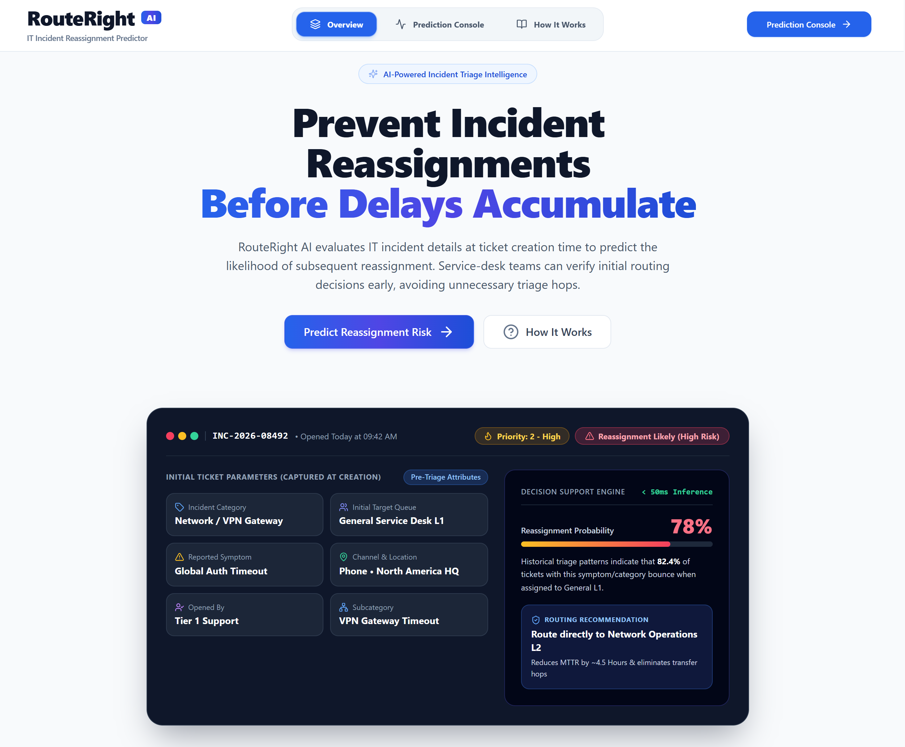
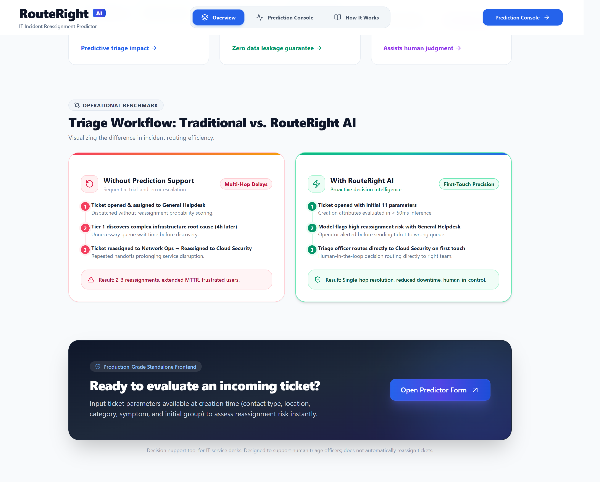
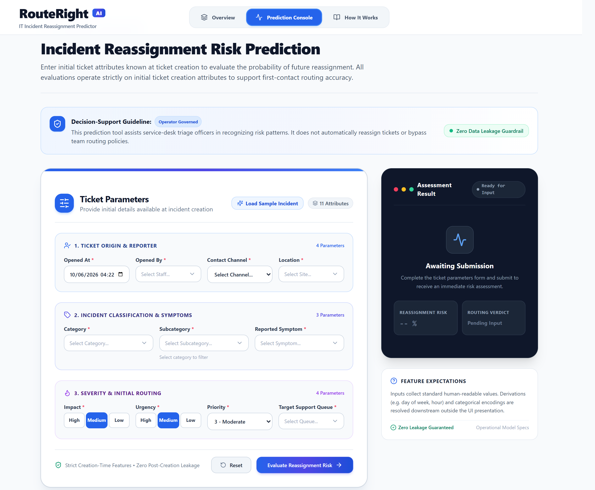

# RouteRight AI

**Predict IT support ticket reassignment risk before the next handoff.**

RouteRight AI helps service-desk teams review initial ticket routing. Enter the information available when an incident is created, and the app estimates whether it is likely to need reassignment later.

This project brings together a data-mining workflow, a trained Random Forest model, a FastAPI prediction service, and a React interface. Built for **IT3051 - Fundamentals of Data Mining | Mini Project 2026**.

> RouteRight AI supports human decisions. It does not automatically reassign tickets or select the best destination team.

## Preview

### Overview



### Triage workflow



### Prediction console



The overview uses illustrative scenarios. Its example recommendations, time savings, and latency claims are not measured guarantees or outputs of the prediction API.

## What the app does

- Collects 11 creation-time ticket attributes in a validated form.
- Provides searchable dropdowns, category-based subcategory filtering, and a **Load Sample Incident** button.
- Sends ticket details to the backend for preprocessing and model inference.
- Displays a reassignment verdict, probability, risk level, decision threshold, model name, and inference time.
- Includes loading feedback, error messages, retry, and form reset.

The interface includes an overview (`/`), a prediction console (`/predict`), and an explanation of the system (`/about`). Dropdown labels are local demo data mapped to anonymized dataset values; they are not a live service-desk directory.

## Run locally

You will need **Python 3.14 or newer** (as specified in `pyproject.toml`), **Node.js 22 with npm**, and two terminals. The commands below assume you have cloned the repository and opened its root folder.

### 1. Start the backend

Using uv:

```powershell
uv sync --locked
uv run uvicorn app.backend.main:app --reload --port 8000
```

Alternatively, create and activate a virtual environment, then install the exported dependencies:

```powershell
python -m venv .venv
.\.venv\Scripts\Activate.ps1
python -m pip install -r requirements.txt
python -m uvicorn app.backend.main:app --reload --port 8000
```

On macOS or Linux, activate the environment with `source .venv/bin/activate`.

The backend loads these existing files at startup:

```text
models/final/final_model.pkl
models/final/final_model_meta.json
models/preprocessing_pipeline.pkl
```

You do not need to rerun the notebooks to use the app when these artifacts are available and compatible with your Python environment.

- Health status: `http://localhost:8000/health`
- Interactive API documentation: `http://localhost:8000/docs`

A ready backend reports `status: "healthy"` and `artifacts_loaded: true`. Check the response body: the health endpoint can return HTTP 200 with a `degraded` status when artifacts cannot load.

### 2. Start the frontend

In a second terminal, from the repository root:

```powershell
cd app/frontend
npm ci
```

If you do not already have a local `.env` file, copy the example:

```powershell
Copy-Item .env.example .env
```

On macOS or Linux, use `cp .env.example .env` instead. Set the backend address in `.env`:

```dotenv
VITE_API_BASE_URL=http://localhost:8000
```

Then start Vite:

```powershell
npm run dev
```

Open the URL printed in the terminal, normally `http://localhost:5173`.

`VITE_API_BASE_URL` defaults to `http://localhost:8000` when unset or empty. Use an origin without a trailing slash and restart Vite after changing `.env`. The example file also contains `VITE_USE_MOCK_API`, but the current code does not use it: prediction requests always call the backend.

### 3. Try a prediction

1. Open **Prediction Console**.
2. Click **Load Sample Incident**, or enter the ticket details yourself.
3. Click **Evaluate Reassignment Risk**.
4. Review the assessment alongside your team's routing policy.

| Input group | Fields |
| --- | --- |
| Ticket origin and reporter | Opened At, Opened By, Contact Channel, Location |
| Classification and symptoms | Category, Subcategory, Reported Symptom |
| Severity and initial routing | Impact, Urgency, Priority, Target Support Queue |

The form requires all 11 fields. The API also supports missing values for several categorical fields, as documented in its request schema.

## How predictions work

```text
Ticket details -> React form validation -> POST /predict
               -> Normalization and fitted preprocessing
               -> Random Forest -> Assessment shown in the UI
```

The backend derives time features from `opened_at`, normalizes categorical identifiers, applies the saved preprocessing pipeline, and aligns the input with the model's 109 features.

The current decision threshold is **0.5**, read from the saved model metadata:

| Probability | Prediction | Risk level |
| --- | --- | --- |
| At least 0.5 | Reassignment Required (`1`) | High |
| Below 0.5 | No Reassignment Required (`0`) | Low |

These are model estimates, not guarantees about individual tickets.

## Dataset and modelling

The project uses the **Incident Management Process Enriched Event Log** by Amaral, Fantinato, and Peres (2018), available from the [UCI Machine Learning Repository](https://doi.org/10.24432/C57S4H).

| Property | Value |
| --- | --- |
| Raw event records | 141,712 |
| Unique incidents | 24,918 |
| Raw attributes | 36 |
| Dataset license | CC BY 4.0 |
| Task | Supervised binary classification |
| Target | `reassignment_required`: `1` when the incident's final `reassignment_count > 0`, otherwise `0` |

Multiple event rows are reconstructed into one record per incident. Inputs use the initial ticket state; later lifecycle information, including reassignment counts and resolution fields, is excluded from prediction features.

The workflow includes:

1. **Data understanding and reconstruction:** inspect the event log, reconstruct incidents, and derive the target.
2. **Exploratory analysis:** investigate class balance, missing values, categorical distributions, and operational patterns.
3. **Preprocessing:** clean categorical values, group rare categories, encode inputs, and derive time features.
4. **Leakage validation and splitting:** sort incidents chronologically and use an 85% training / 15% test split, fitting preprocessing on training data.
5. **Baseline comparison:** evaluate Logistic Regression, Decision Tree, Random Forest, and Gradient Boosting, including weighted and unweighted variants.
6. **Tuning and selection:** compare tuned models using five-fold `TimeSeriesSplit` on the training set.
7. **Final evaluation:** assess the selected model on the held-out test set and export evaluation artifacts.

### Model comparison and final selection

Four algorithms were trained and compared: **Logistic Regression, Decision Tree, Random Forest, and Gradient Boosting**. Baseline experiments tested weighted and unweighted variants, followed by hyperparameter tuning. Each tuned model was evaluated on the same five chronological cross-validation folds within the training set, keeping the held-out test set separate from model selection.

**PR-AUC was the primary selection metric**, measuring how well the models rank reassignment cases across precision-recall tradeoffs. F1, recall, precision, accuracy, and ROC-AUC provided supporting evidence.

The [saved baseline and tuning comparison](docs/deliverables_eval2/tuning/tuning_baseline_vs_tuned.csv) reports these mean cross-validation scores:

| Model | Best baseline PR-AUC | Tuned PR-AUC | Tuned F1 | Tuned recall |
| --- | --- | --- | --- | --- |
| **Random Forest** | **0.7374** | **0.7611** | **0.6802** | **0.6731** |
| Gradient Boosting | 0.7308 | 0.7537 | 0.6739 | 0.6533 |
| Logistic Regression | 0.7178 | 0.7183 | 0.6226 | 0.6225 |
| Decision Tree | 0.5515 | 0.6917 | 0.6359 | 0.6418 |

**Random Forest was selected as the most suitable model for the final system** because it achieved the highest tuned mean PR-AUC, F1, and recall among the four candidates. It outperformed Gradient Boosting on PR-AUC in four of five folds, although its mean lead was modest (0.0074). Gradient Boosting achieved slightly higher accuracy and precision, so Random Forest's selection reflects the project's ranking and reassignment-detection objectives rather than superiority on every metric.

Feature-removal experiments also tested whether excluding priority or time features improved performance. They did not show a consistent PR-AUC improvement, so the final model retained all **109 processed features**. The full rationale is recorded in the [model comparison and selection notebook](notebooks/06e_Tuning_Comparison_FinalModel.ipynb).

### Final model and test results

The saved final model is a **Random Forest** with 500 trees, balanced class weights, `min_samples_leaf=2`, and `max_features="sqrt"`.

The following values come from the repository's [saved test evaluation](docs/deliverables_eval2/evaluation/test_metrics.json), using **3,738 test incidents** and a **0.5 threshold**:

| Metric | Value |
| --- | --- |
| Accuracy | 75.07% |
| Precision | 65.02% |
| Recall | 71.11% |
| F1 score | 0.6793 |
| ROC-AUC | 0.8226 |
| PR-AUC | 0.7559 |

These are recorded experiment results, not a fresh evaluation from installing or starting the app. The test set's reassignment rate is 37.13%, compared with 47.12% in training, so changes over time matter when interpreting performance.

## Repository guide

```text
.
|-- app/
|   |-- backend/              # FastAPI, schemas, model loading, transformers, inference
|   `-- frontend/             # React + TypeScript app, tests, and preview images
|-- config/                   # Configuration folder
|-- data/
|   |-- raw/                  # Original incident event log
|   |-- interim/              # Intermediate incident-level datasets
|   `-- processed/            # Prepared datasets and train/test CSVs
|-- docs/
|   |-- data_preprocessing/   # Feature decisions and preprocessing summaries
|   |-- deliverables_eval1/   # Safe feature list
|   `-- deliverables_eval2/   # Baseline, tuning, and final evaluation artifacts
|-- eda_figures/               # Saved exploratory charts
|-- models/
|   |-- baseline/             # Baseline model artifacts
|   |-- tuned/                # Tuned model artifacts
|   |-- final/                # Selected model and metadata
|   `-- preprocessing_pipeline.pkl
|-- notebooks/                # Data preparation, baselines, tuning, and evaluation
|-- tests/                    # Backend API and predictor tests
|-- pyproject.toml            # Python project requirements
|-- requirements.txt          # Exported Python dependencies
`-- uv.lock                   # Locked Python environment
```

### Explore the notebooks

Start with these notebooks in order:

| Stage | Notebook |
| --- | --- |
| Reconstruction | [01_Data_Understanding_Reconstruction.ipynb](notebooks/01_Data_Understanding_Reconstruction.ipynb) |
| EDA | [02_EDA.ipynb](notebooks/02_EDA.ipynb) |
| Preprocessing | [03_Preprocessing_FeatureEngineering.ipynb](notebooks/03_Preprocessing_FeatureEngineering.ipynb) |
| Leakage checks and split | [04_Leakage_Validation_Split.ipynb](notebooks/04_Leakage_Validation_Split.ipynb) |
| Baselines | `05a` through `05e` in `notebooks/` |
| Tuning and final selection | `06a` through `06e` in `notebooks/` |
| Held-out evaluation | [07_Model_Evaluation.ipynb](notebooks/07_Model_Evaluation.ipynb) |

The raw dataset belongs at `data/raw/incident_event_log.csv`. Notebook outputs include saved models, processed CSVs, charts, and evaluation summaries. Review the notebooks before rerunning them because they can overwrite these artifacts.

## Development and checks

The frontend uses React 18, TypeScript, Vite 5, Tailwind CSS 3, React Router 6, React Hook Form, Zod, and Lucide React. API requests use browser `fetch`. The Python workflow uses pandas, NumPy, scikit-learn, Matplotlib, Seaborn, and Jupyter; FastAPI and Uvicorn serve inference.

Run frontend commands from `app/frontend`:

| Command | Purpose |
| --- | --- |
| `npm run dev` | Start the development server |
| `npm run build` | Check TypeScript and build into `dist/` |
| `npm run preview` | Preview an existing production build |
| `npm test` | Run Vitest tests once |
| `npm run test:watch` | Run tests in watch mode |
| `npm run lint` | Run ESLint with zero warnings allowed |
| `npm run format:check` | Check source formatting |
| `npm run format` | Format supported source files |

Backend tests cover API contracts, validation, preprocessing, and prediction behavior. From the repository root, with the Python environment activated:

```powershell
python -m pip install pytest httpx
python -m pytest tests
```

`pytest` and `httpx` are needed for these tests but are not declared in the current project dependencies. Tests that load the real model require the saved artifacts.

For production hosting, set the frontend API URL before building and configure the frontend host to serve `index.html` for browser routes such as `/predict` and `/about`.

## Troubleshooting

| Issue | What to check |
| --- | --- |
| Prediction request fails | Confirm the backend is running and the frontend API URL matches its address. Check `/health` and the backend terminal. |
| Backend reports `degraded` | Verify the model, metadata, and preprocessing files exist and can load with the installed Python dependencies. |
| Mock mode still makes API calls | `VITE_USE_MOCK_API` is unused. Only the dropdown choices are local demo data. |
| Subcategory clears after changing category | Choose a subcategory from the newly filtered list. |
| Refreshing a hosted frontend route fails | Configure the host's fallback to `index.html`. |

## Team

| Member | Responsibilities |
| --- | --- |
| Vidanapathirana A.U.S | Data understanding, incident reconstruction, target construction, and backend implementation |
| A.A.V. Pahasera | Exploratory analysis, data quality analysis, and backend implementation |
| M.A.M.D.H. Muhandiram | Data cleaning, preprocessing, feature engineering, and frontend implementation |
| I.A. Samararathna | Leakage validation, feature finalization, and train/test pipeline |

## Limitations and responsible use

- The data comes from one organization's anonymized ServiceNow records; performance may differ in other environments.
- The target is derived from historical reassignment counts. A reassignment does not by itself prove that the original routing was wrong.
- Readable dropdown labels and category mappings are demo choices, not verified descriptions of the anonymized source identifiers.
- Model outputs should support operational review, with final routing decisions made by service-desk staff.
- The app does not establish measured reductions in handling time, reassignment volume, or downtime.

## Dataset citation

Amaral, C. A. L., Fantinato, M., & Peres, S. M. (2018). *Incident Management Process Enriched Event Log* [Dataset]. UCI Machine Learning Repository. [doi:10.24432/C57S4H](https://doi.org/10.24432/C57S4H).
